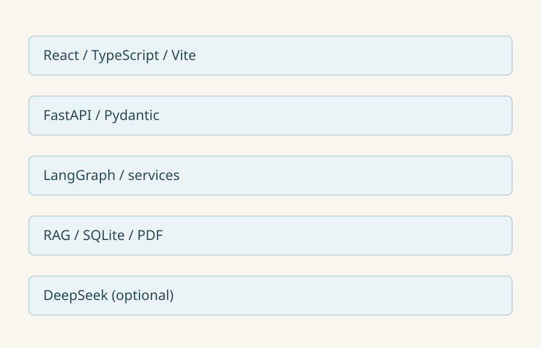

# fireFairy · 火灵

面向多语种科研文献的知识挖掘与科学发现 Agent。当前验证领域为厌氧消化。
版本 4.0.0。本目录为独立封版候选。质量门禁见 [发布报告](docs/release-report.md)。

八项能力包括文献比较、反证推理、科研空白雷达、实验设计、多模态证据、
证据图谱、可靠性审计和结论演化。各模块共享可追溯的论文、实验记录和图表 ID。

## 环境与安装

Windows CMD，Python 3.11，Node.js 22 或 24，npm。
在解压后的项目根目录执行以下命令。首次安装需要网络，OCR 另需 Tesseract。

~~~cmd
py -3.11 -m venv backend\.venv
backend\.venv\Scripts\python.exe -m pip install -c backend/requirements-lock.txt -e "backend[test]"
npm --prefix frontend ci
copy .env.example .env
~~~

模板默认关闭外部模型。启用时在本机 .env 配置 LLM_API_KEY、USE_LLM 和可用模型名。
ADMIN_TOKEN 留空会关闭管理员接口，请使用新生成的随机值。
DATABASE_URL 相对后端目录，启动脚本会切换工作目录。

## 数据初始化

按 [文献获取说明](docs/data.md) 准备有权使用的 PDF，
放入 knowledge/literature_corpus/inhibition、theory 或 engineering。
本地演示包按用户授权附带当前知识库的 58 篇 PDF。首次执行初始化生成数据库和索引；公开再分发权限仍需独立核查。

~~~cmd
backend\.venv\Scripts\python.exe scripts\initialize.py
~~~

初始化创建 SQLite、解析 PDF 并构建 TF-IDF 索引。有数据的库会拒绝初始化。
现有管理员入库端点具有替换数据语义，操作前应备份。

## 启动

~~~cmd
open.cmd
~~~

或在两个 CMD 窗口分别执行

~~~cmd
cd backend
.venv\Scripts\python.exe -m uvicorn app.main:app --host 127.0.0.1 --port 8001
~~~

~~~cmd
cd frontend
npm run dev -- --host 127.0.0.1
~~~

工作台 http://127.0.0.1:5174/ 。API 文档 http://127.0.0.1:8001/docs 。

## 验证

~~~cmd
cd backend
.venv\Scripts\python.exe -m pytest tests -q
cd ..
npm --prefix frontend run typecheck
npm --prefix frontend run build
~~~

完整测试含原 58 篇知识库的断言，小规模新库会有数据前置条件失败。
无文献时可先运行以下确定性测试，其结果不能替代真实论文验收。

~~~cmd
cd backend
.venv\Scripts\python.exe -m pytest tests/test_experiment_design.py tests/test_research_gap_coverage.py tests/test_research_compare_endpoints.py -q
~~~

## 演示

输入“厌氧消化中氨水平对甲烷产量有显著影响吗？”，核对 Wang 原文的菌种和 P 值。
输入“比较 Wang 2015 与 Yang 2018：氨水平对甲烷产量有显著影响吗？”。回答完成后点“比较本轮文献”，自动带入问题和真实证据并开始比较。
挑战 TAN 结论，打开证据覆盖，选中温 FAN 单元格，再生成实验草案。
实验水平需由用户确认，论文观测值不等于推荐操作条件。
多模态证据跳转原页，图谱观点可继续审计和查看时间线。

本地模式输出摘录或已识别结果摘要。本轮中英及混合语言真实模型验收见 docs/multilingual-acceptance.md。
图表识别、实验提取及年代判断均有适用边界。
详见 [作品介绍](docs/fireFairy作品介绍.md)、[API](docs/api.md) 和 [架构](docs/architecture/README.md)。

## 本轮验收与实机图

离线真实接口联调（需要先初始化）：

~~~cmd
backend\.venv\Scripts\python.exe scripts\verify_release.py
~~~

真实模型验收：先在本机配置自己的新凭据并启用模型，再启动后端。
下面命令会经后端将六道问题及检索片段发送给配置的模型服务；验收使用 DeepSeek 官方服务。

~~~cmd
backend\.venv\Scripts\python.exe scripts\verify_multilingual.py
~~~

所有页面的实机图见 [截图索引](docs/screenshots/README.md)。
双击 docs/screenshots/gallery.html 可打开桌面和手机图集。
所有图来自真实界面操作。多模态页展示原图、表格行列、图注和原图入口。
本包没有 .env、个人密钥、数据库或缓存，不会自动使用作者的模型额度。

## 相关材料

- [火灵厌氧运行 Agent 完整介绍（脱敏版）](火灵厌氧运行Agent-完整介绍.md) —
  工业厌氧罐值班数字工程师方向的产品说明。与本仓库的科研文献方向同属「火灵」品牌，但是两条不同的产品线。
