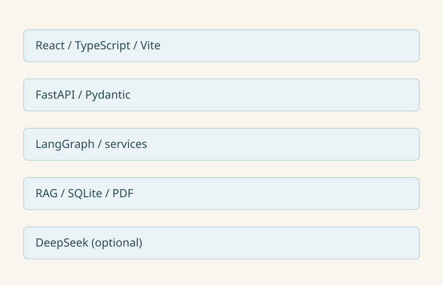
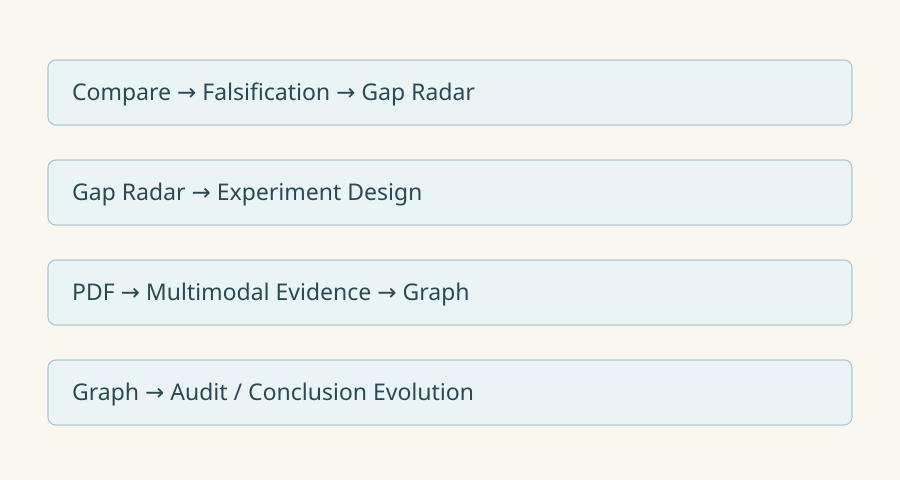
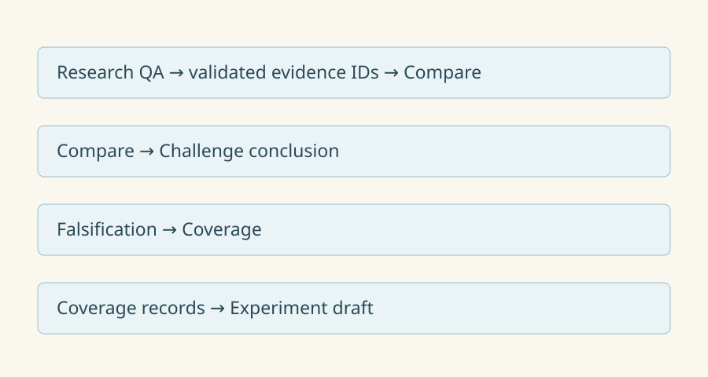
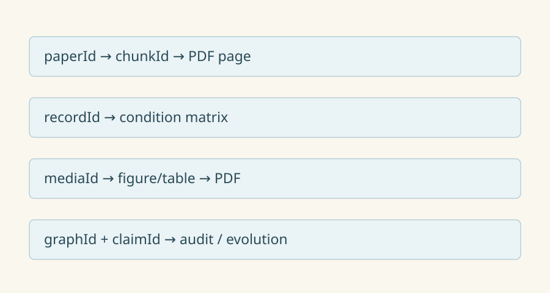

# 实际架构

问答和比较采用 LangGraph。其他能力复用比较结果、确定性服务或证据图谱。
问答按真实分块 ID 转入比较；服务器核对来源与页码后沿用论文范围，自动提交。
knowledge_chunks 保存论文分块，(source_id, chunk_index) 唯一，page 从 1 开始。
audit_logs 保存事件。图谱 SQLite 保存快照，媒体 SQLite/PNG 保存可重建缓存。
PDF 是事实来源。userProvided / proposed 表示用户输入或建议。
