# 全页面实机截图

全部来自本轮真实浏览器操作，含桌面 1600×1100 与手机 390×844。
问答实际调用模型，其他工作台实际提交 API；无 Mock 响应、无合成结果。

## 开始页

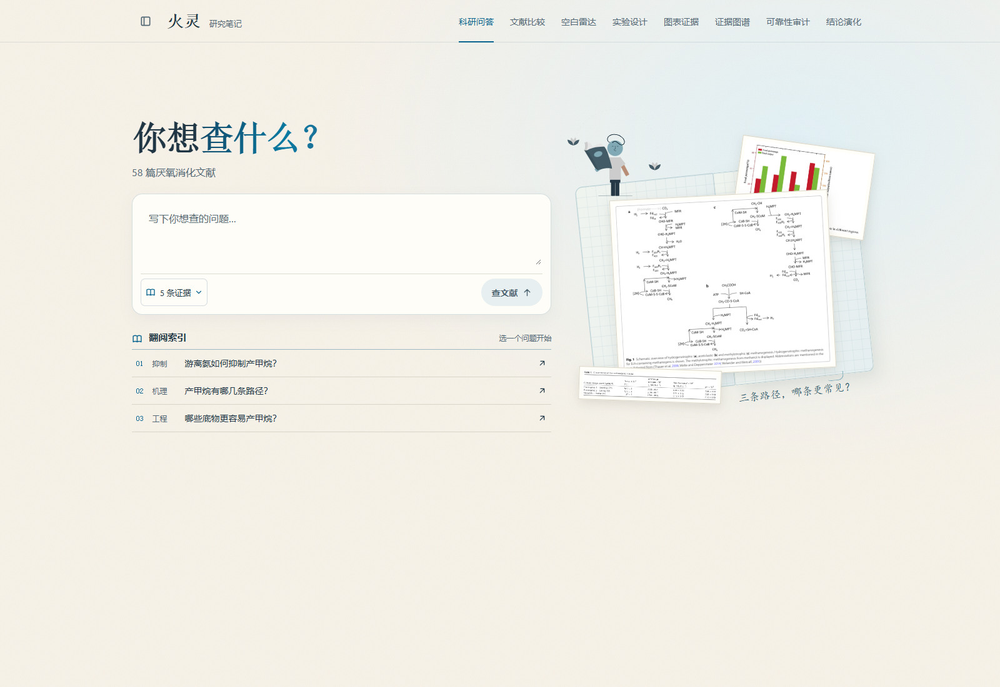

[手机实机图](home-mobile.png)

[手机完整长图](home-mobile-full.png)

## 科研问答

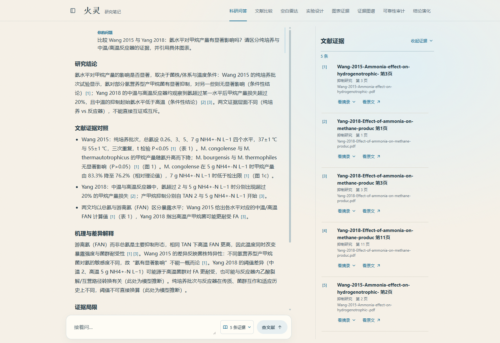

[手机实机图](qa-mobile.png)

## 回答正文与原表

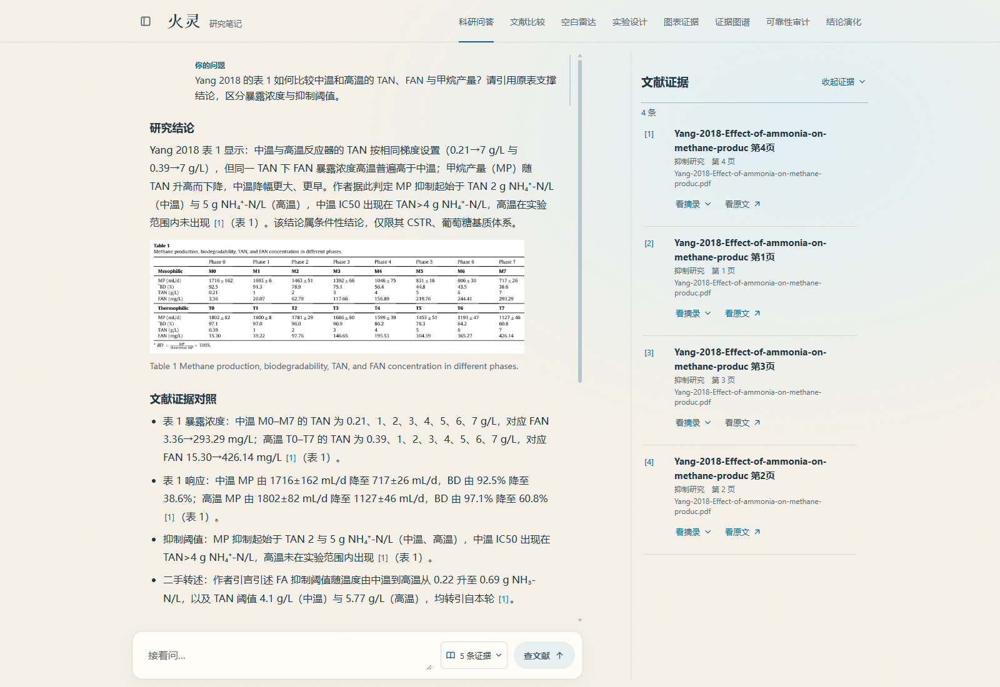

[手机实机图](qa-multimodal-mobile.png)

## 文献比较

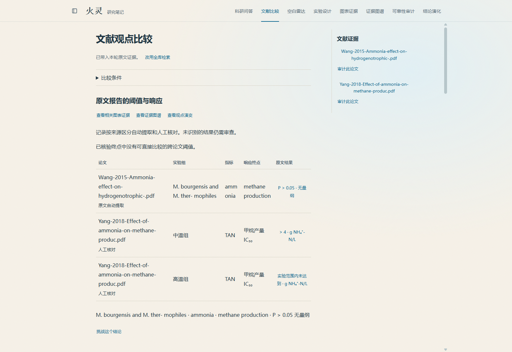

[手机实机图](compare-mobile.png)

## 反证报告

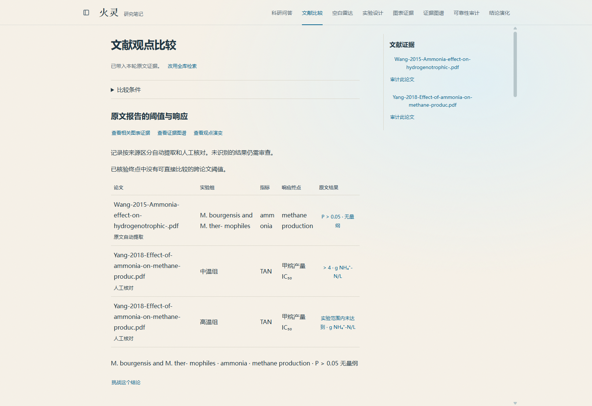

[手机实机图](falsification-mobile.png)

## 空白雷达

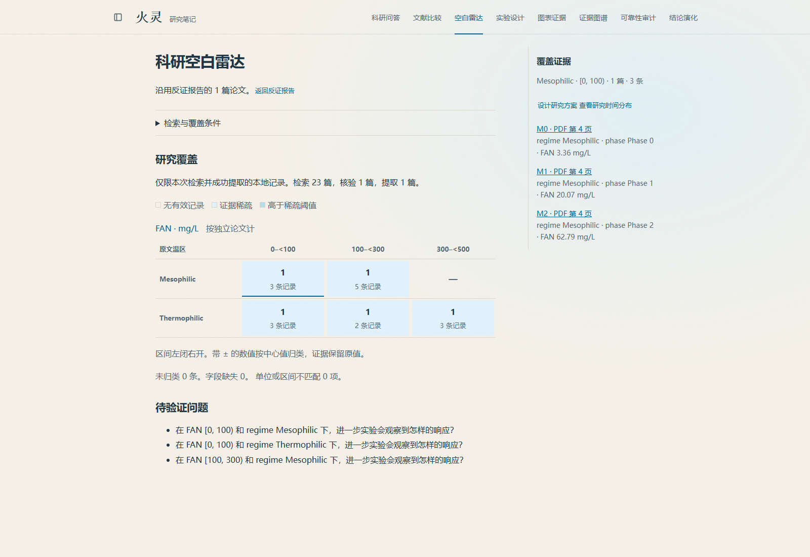

[手机实机图](gaps-mobile.png)

## 实验设计

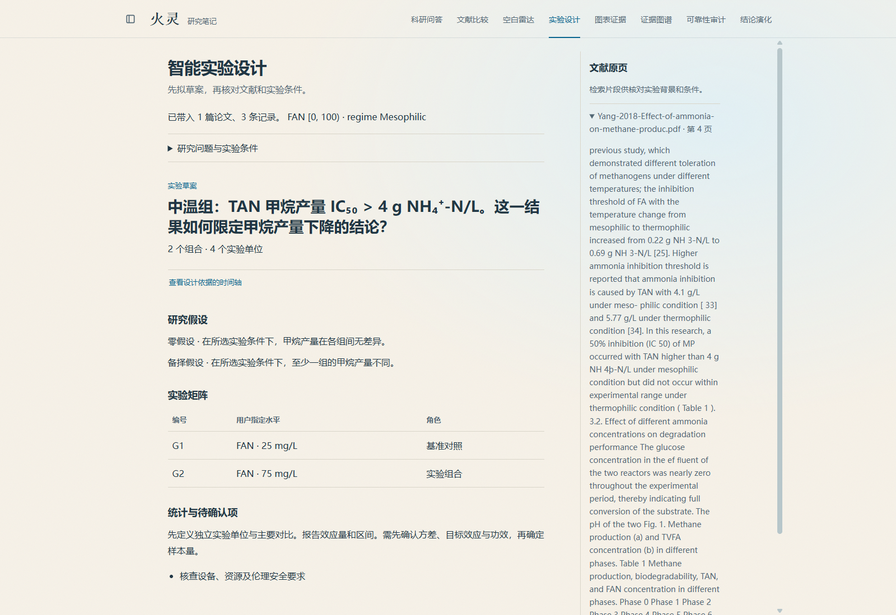

[手机实机图](design-mobile.png)

## 多模态原图

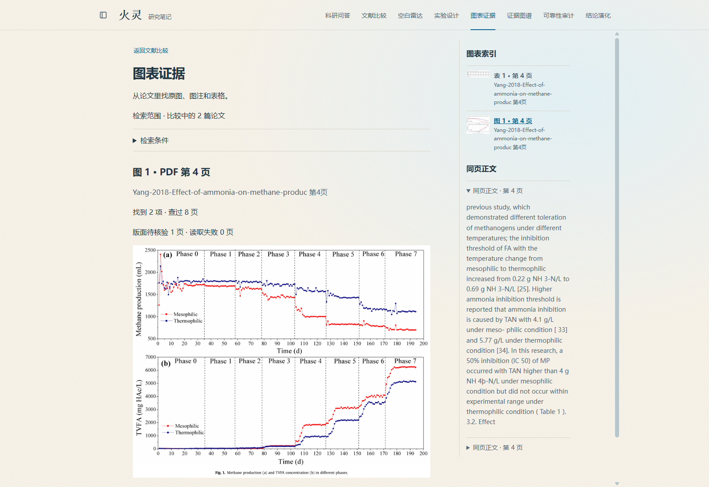

[手机实机图](media-mobile.png)

## 表格与原文

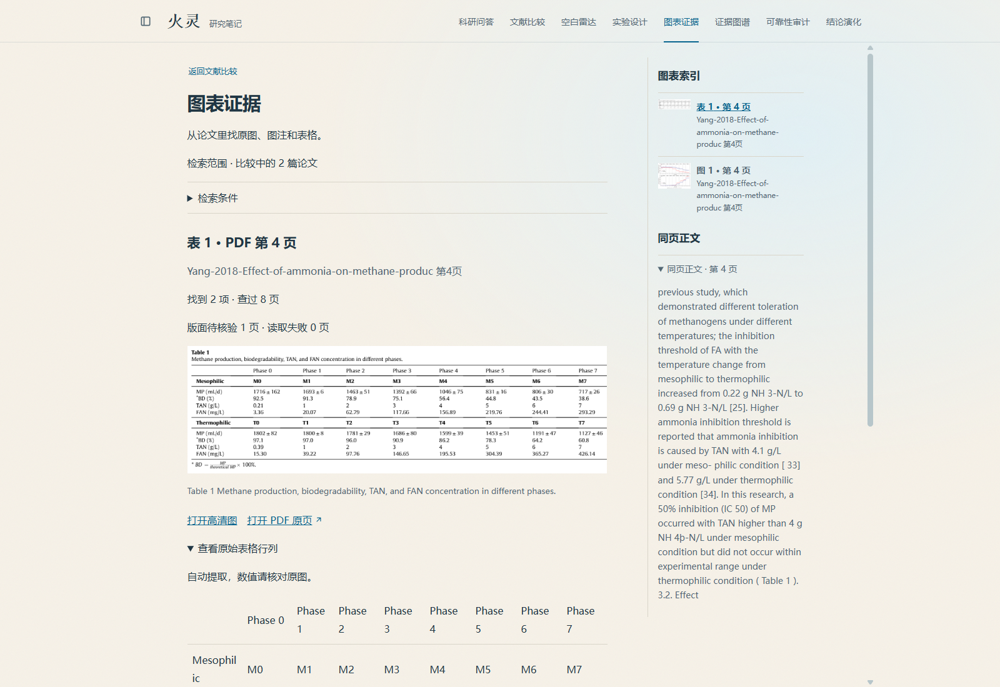

[手机实机图](media-table-mobile.png)

## 原表与提取行列

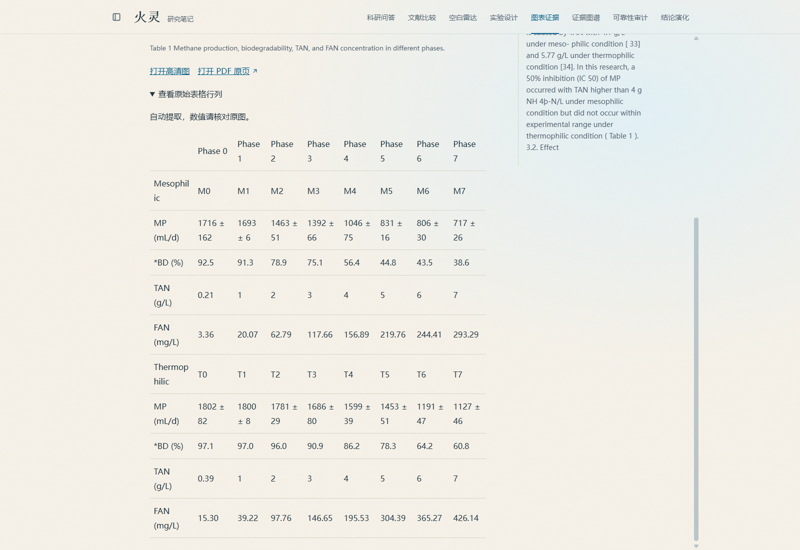

[手机实机图](media-data-mobile.png)

## 证据图谱

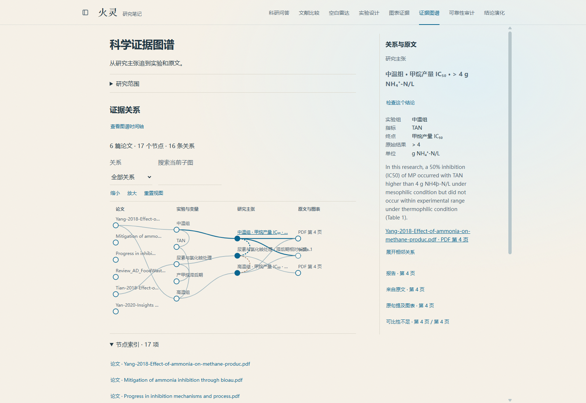

[手机实机图](graph-mobile.png)

## 可靠性审计

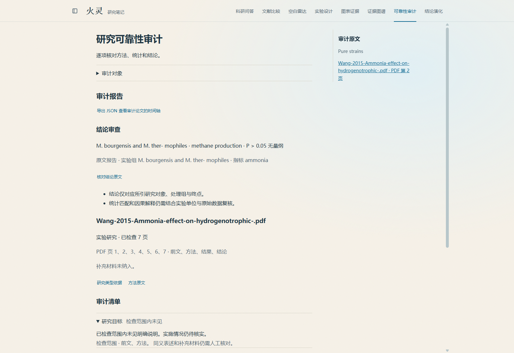

[手机实机图](audit-mobile.png)

## 结论演化

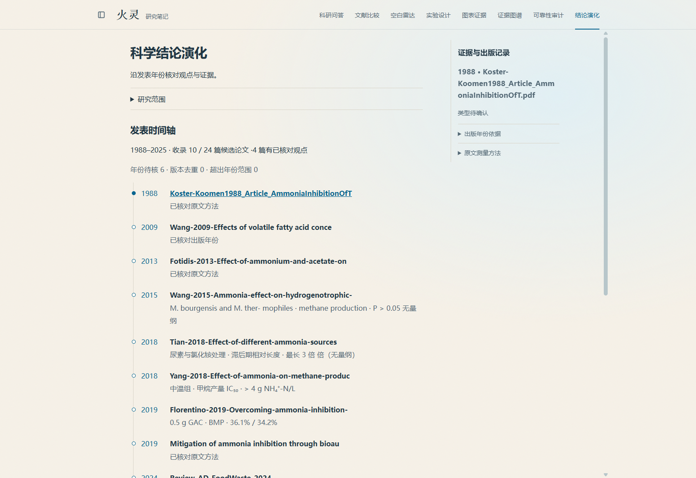

[手机实机图](evolution-mobile.png)

