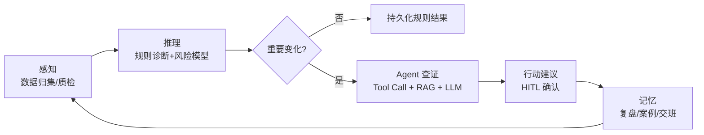
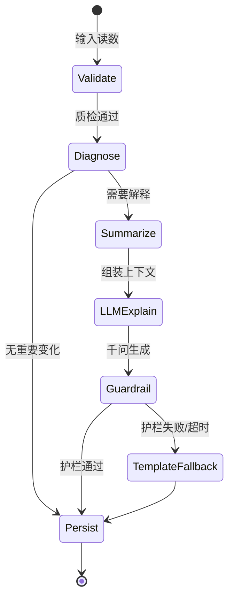
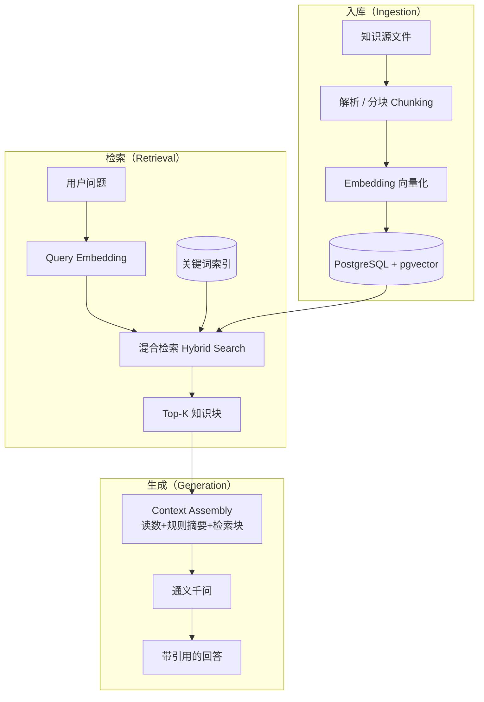

# 火灵厌氧运行 Agent · 完整介绍（技术版）

> 面向参赛稿与工程团队的底稿。在保留业务事实的前提下，从 **Agent 系统工程** 视角补全大模型相关术语、架构分层与技术选型说明。  
> **版本：** `fireling-v3-2026-09-07-tech`  
> **单位：** 珠海市逸水智元科技有限公司  
> **数字与客户口径：** 以 `config/submission.yaml` 为准；改价格、回测、客户状态先改 YAML，再改本文。  
> **实现依据：** 仓库目录、`docker-compose.yml`、`.env.example`、当前值班界面。未在 Docker 里跑通的，文中标成「产品设计 / 落地路径」，不要改成「已经在现场无人值守」。

---

## 0. 文档使用说明

其他工程师改亮点时，请遵守：

1. **事实不要改。** 分数谁出、模型干什么、端口、客户状态、回测口径，以本文和 YAML 为准。  
2. **可以改的是强调。** 把更像 Agent 的闭环、千问约束、客户即将落地、值班语言，放到段首；把目录、接口清单往后压。  
3. **已实现 vs 设计分开。** 「Docker 打开就能演示」和「两周校准、一厂一 Agent 的交付方法」不要混成同一句「已经自动完成」。  
4. **不要新编数字。** 需要新案例或新截图，补附件，不要在正文里估一个准确率。

文末有「改亮点清单」，可直接当修改任务表。

### 0.1 技术读者速览

| 维度 | 火灵采用的方式 |
|------|----------------|
| Agent 范式 | **Tool-using Agent** + **Workflow Orchestration**（非纯 Chatbot） |
| 编排框架 | **LangGraph**（有状态图 / StateGraph） |
| 知识增强 | **RAG**（向量 + 关键词混合检索） |
| 向量存储 | **PostgreSQL + pgvector** |
| 确定性决策 | **BioGuard 规则引擎** + **LightGBM** 风险模型 |
| 大模型 | **通义千问 qwen3.8-max**（OpenAI 兼容 API / DashScope） |
| 工具协议 | **MCP**（Model Context Protocol）只读工具集 |
| 可观测性 | `trace_id` 全链路审计 |
| 部署 | **Docker Compose** 三服务（db / api / frontend） |

---

## 1. 这是什么

**火灵**是面向工业厌氧罐（UASB / IC 等）的 **值班数字工程师 Agent**。从系统形态看，它不是聊天框，也不是模块清单，而是一套 **Docker 可运行的值班 / 管理双视图工作台**，后端以 **FastAPI + LangGraph 工作流** 驱动，前端为 Nginx 静态 SPA。

当班要交出来的是四件事：

1. 现在稳不稳  
2. 未来几天会不会往失稳走  
3. 先补测什么、先看什么  
4. 交班留下什么  

火灵按这个任务交付可验收产物：基础运行分与等级、动作建议、带引用的工艺问答、本班任务、交接班摘要、异常复盘档案。

**产品边界：** 旁路接入（Sidecar / Read-only Integration）。读数进来，判断和说明出去。不替换现有 PLC / SCADA，不向现场下发加药或进水控制。高风险动作由值班确认——符合 **Human-in-the-Loop（HITL）** 工业 Agent 设计原则。

**标杆客户：** 某国际水务运营商（下称客户 A），现场位于华南某工业园区的工业污水处理厂，对象为其 UASB 1# / 2#。已签订合作协议，本 Agent 即将落地实际系统。不要写成已在客户旗下全部工厂无人值守运行。

**演示入口（本机 Docker）：**

| 服务 | 地址 |
|------|------|
| 值班界面 | http://localhost:15173/ |
| API 文档 | http://localhost:18000/docs |
| 健康检查 | http://localhost:18000/health |
| PostgreSQL | localhost:15432 |

---

## 2. 现场问题（为什么要做 Agent）

厌氧罐通常不会突然倒下。负荷、毒性或操作变化后，产酸仍快、产甲烷跟不上，VFA 尤其是丙酸先积累，碱度暂时托住 pH；随后才是 pH 下跌、出水恶化、产气下降、停车恢复。

**客户现场记录（2025-08-27）：** 反应器 pH 仍为 7.46 时，丙酸已占 VFA 约 61.7%，距 pH 跌破 6.5 大约还有 4 天窗口。窗口期内如果没有组合判断和班次记忆，后面才是事故。

现有工具各管一段：

| 现有方案 | 能做什么 | 缺什么 |
|----------|----------|--------|
| 在线仪表 | 看见单个读数 | 不会解释组合 |
| SCADA | 越限报警 | 多在已经越限之后 |
| 通用工业互联网 / 智慧水务 | 全厂信息化 | 吃不透厌氧工段 |
| 专家驻场 | 经验判断 | 贵，且经验随人走 |

一线真正缺的是：**组合判断**（pH 还正常时能否看见酸化前兆）和 **班次记忆**（上一班怎么判断、补测了没有、结果如何）。火灵按班次把这两件事做成可复查的 **Agent 工作流（Shift Workflow）**。

现场对象补充（工程背景，用于理解数据，不写成已无人值守）：

- 两座 UASB，单座约 150 m³，设计 OLR 约 3.6 kgCOD/m³·d  
- 进水为制药 / 化工混合工业废水，浓度与 pH 波动大  
- 历史序列约 15 个月可回放（演示数据在库中，不是实时仪表）

---

## 3. Agent 完整能力（按值班闭环）

把「罐稳不稳」拆成可执行步骤。下面每条都能在当前界面找到对应页。从 Agent 工程视角，可映射为 **感知 → 推理 → 行动 → 记忆** 四段闭环。



### 3.1 通信与数据归集（Perception Layer）

仪表读数、化验单、CSV/XLS 导入进入同一罐体时间轴。先做 **数据质量检查（Data QA）**：时间对齐、单位、缺失。缺测标明，不拿 0 分冒充已测。罐体隔离：无数据的罐显示尚未接入，禁止借用其他罐数据（**多租户数据隔离**）。

界面：数据导入、罐体切换、读数条。工程师确认导入需管理员令牌。

### 3.2 诊断（Deterministic Reasoning）

BioGuard 最小参数规则用四项给出**基础运行分**和等级：进水 pH、进水 COD、反应器 pH、出水 COD。VFA、碱度、丙酸等扩展指标缺测时不按 0 分，并单独显示覆盖情况。

默认 `DIAGNOSIS_MODE=rules_primary`：健康分与等级由 **确定性规则引擎** 计算，大模型 **不得改写（Non-overridable Score）**。另有规则封顶、异常检测（Isolation Forest）取严，以及客户场景规则。未来 3/7 日失稳风险在规则主路径下由 **LightGBM** 给出参考概率（`/v1/risk/predict`），界面不把该概率写成当前健康分。

> **设计原则：** 工业场景采用 **Neuro-Symbolic** 架构——符号规则负责可审计决策，神经网络（LLM / GBDT）负责解释、检索增强与辅助推断。

### 3.3 预警与本班任务（Task Planning）

当前健康与未来失稳风险分开。预警记录触发时间、触发时状态、当前是否仍异常、复测关闭条件。值班可确认（ack）并记录动作。触发时间和「现在怎样」必须分开读，避免把历史报警当成此刻正在崩。

界面：值班「本班任务」；管理「风险与任务」。

### 3.4 智能建议（Action Proposal）

分数或趋势变化后，给出补测、复测窗口、升级与停止条件。建议是 **辅助判断（Advisory Output）**，不是控制指令。强操作需人确认。

### 3.5 自主查证（Agentic Investigation）

重要变化后，**LangGraph 编排层**根据状态机选择 **只读 Tool**，调用历史趋势、知识检索、同罐案例，再让千问写短结论。正常波动 **不触发 LLM 调用（Lazy Invocation）**。超时则 **模板降级（Graceful Degradation）**，规则分数保留。

这是典型的 **ReAct / Tool-using Agent** 行为：Planner 决定调哪些工具 → Executor 执行只读查询 → LLM 基于结构化上下文生成解释。

### 3.6 工艺问答（RAG + Grounded Generation）

**RAG（Retrieval-Augmented Generation）** 流程：用户提问 → 混合检索知识块与案例 → 拼接当班读数、规则摘要 → 通义千问生成回答 → **强制引用（Citation-required Generation）**。

资料未命中则说明依据不足（**Abstain when no evidence**）。现场题约束在厌氧工段：例如出水 COD 高于进水，应先查取样、HRT、跑泥与酸化，而不是跳到好氧曝气 / 硝化——通过 **System Prompt + Output Guardrails** 实现领域约束。

界面：工艺问答。可从总览把日期和预设问题带过去。

### 3.7 异常复盘与交接班（Agent Memory）

复盘：当时分数、判断、处置、结果、可复用经验，可归档为案例并 **入库参与 RAG 检索（Case Memory）**。  
交接班：本班判断、已确认动作、未关闭事项；摘要只整理已发生的事实，不把建议写成已经执行。

### 3.8 历史回看、运行资料、单次快检

历史回看 / 管理侧运行趋势：按时间看序列，不是「线上生产准确率报表」。  
运行资料：规程、文献、案例的可管理知识库（**Knowledge Base Admin**）。  
单次快检：临时填进出水 pH、COD 等做一次规则检测。

### 3.9 多 Agent 配置与反馈（Multi-Agent Profile）

系统支持多套 **Agent Profile（档案）**：默认 Agent、每套独立 Prompt、值班反馈、判断校验 / 训练运行。这是「一厂一专用 Agent」在软件上的落点：同一底座，不同厂可以是不同档案、不同提示词、不同反馈，而不是全国共用一个聊天提示。

工程师模式可见判断校验；管理视图有专业能力验证（六道内部对比题，不作外部盲评准确率）。

---

## 4. 给谁用、界面怎么组织

### 4.1 用户

| 角色 | 当班任务 | 主视图 |
|------|----------|--------|
| 值班员 | 稳不稳、补测、交班 | 值班视图 |
| 工艺工程师 | 趋势、建议核对、负荷 | 值班 + 历史回看 |
| 生产主管 | 未关闭风险、覆盖、可复查记录 | 管理视图 |
| 内部工程师 | 规则证据、Prompt、导入、trace | 工程师模式 |

界面说运行语言（稳不稳、先补测什么），不把 RAG、Prompt、LLM 作为客户主文案。工程师模式才展开 **trace 与原始记录（Observability UI）**。

### 4.2 值班视图（当前导航）

| 页面 | 作用 |
|------|------|
| 运行总览 | 基础运行分、等级、变化、缺测、本班建议；可后台重新评估并看真实进度 |
| 本班任务 | 预警与待办、确认、复测 |
| 工艺问答 | 带引用的提问 |
| 异常复盘 | 事件档案 |
| 交接班 | 班次交接 |
| 历史回看 | 时间序列 |
| 运行资料 | 知识与案例 |
| 数据导入 | 文件入库（写操作） |
| 单次快检 | 临时检测 |
| 判断校验 | 工程师：Prompt、反馈、校验用例 |

### 4.3 管理视图

管理总览、风险与任务、运行趋势、专业能力验证、资料与数据情况。汇总接入状态、数据覆盖、未关闭预警、逾期复测等事实。

### 4.4 工艺口径（值班必须说对）

- pH 落在适宜区间只说明当前酸碱度，不等于没有酸积累。  
- COD 在未核实停留时间与采样对应关系前，只称**表观去除率**，不直接判处理失效。  
- 总 VFA 与碱度是酸与缓冲的优先补测；丙酸是分酸组成的进一步排查，不和总 VFA 并列为同一级缺项。  
- 最小参数四项仍可出基础运行分；扩展项未测时，状态最高按「关注，待补测」理解，不能宣称酸与缓冲都正常。

---

## 5. 判断内核：规则出分，模型说话

这是 Agent 和「套壳聊天（Thin LLM Wrapper）」的分界，也是大赛「大模型结合」要写清的环节。

### 5.1 职责分离（Separation of Concerns）

| 事项 | 组件 | 类型 | 说明 |
|------|------|------|------|
| 健康分、等级 | BioGuard 规则 | 确定性 | 默认 `rules_primary` |
| 异常组合 | 规则 + Isolation Forest 取严 | 确定性 | 模型不覆盖 |
| 未来失稳概率 | LightGBM | 监督学习 | 参考，不替代当前健康分 |
| 解释、问答、查证、交班整理 | 通义千问 `qwen3.8-max` | 生成式 LLM | 不得改分、不得控制 |
| 失败降级 | 本地模板 | 规则模板 | 分数仍在 |

`DIAGNOSIS_MODE=llm_primary` 时，代码允许 LLM 做 health/level 的最终分类器，规则仅参考。**对外参赛与现场演示按 rules_primary 写**：千问不改健康分。不要把仓库里的另一种模式说成当前交付。

### 5.2 BioGuard 基础分（最小参数）

四项原始权重在缺测时重新归一，反应器 pH 权重大（约 64.5%），所以 pH 正常时基础分可以仍高，必须靠缺测提示和趋势把「可能在攒酸」说清楚。

单项：正常区高分，关注区向外线性下降，再叠加趋势 / 波动 / 连续劣化修正。综合后再与规则封顶、异常检测封顶取严。

即时评分必须用**当前读数**；历史只用于斜率、波动和连续变化，不能把历史末值当成今天的分。

### 5.3 LangGraph 工作流编排

**LangGraph** 是构建在 LangChain 生态上的 **有状态 Agent 编排框架**，用火灵仓库中的 **StateGraph** 将值班流程建模为显式状态机，而非单次 Prompt 调用。

#### 5.3.1 图（Graph）定义

| Graph 名称 | 节点链路 | 触发场景 |
|------------|----------|----------|
| `monitor` | 校验 → 诊断 → 落库 | 定时 / 手动评估，无 LLM |
| `explain` | 校验 → 诊断 → 摘要 → 千问解释 → 护栏 | 分数或趋势显著变化 |
| `qa` | 检索 → 组装上下文 → 千问作答 → 引用校验 | 值班提问 |
| `full` | 按 `DIAGNOSIS_MODE` 走诊断或问答；需要解释时才进模型 | 综合入口 |



#### 5.3.2 编排原则

| 原则 | 实现方式 |
|------|----------|
| **Lazy LLM Invocation** | 正常波动不调模型，降低延迟与 Token 成本 |
| **Read-only Tools** | 工具仅读取：读数、诊断、检索、案例、交班记录 |
| **Guardrails** | 输出后检查：禁止改分、禁止下发控制、禁止无来源断言 |
| **Graceful Degradation** | `USE_LLM=false` 或超时 → 本地模板，规则分保留 |

#### 5.3.3 MCP 工具集

火灵通过 **MCP（Model Context Protocol）** 暴露标准化只读工具，供 Agent 编排层调用：

| 工具 | 功能 |
|------|------|
| `list_digesters` | 列出罐体与接入状态 |
| `evaluate_readings` | 调用 BioGuard 规则评估 |
| `search_knowledge` | RAG 知识检索 |
| `list_alerts` | 查询预警与任务 |
| `query_audit_logs` | 审计日志查询 |

MCP 的价值在于 **工具接口与 LLM 解耦**：换模型或换编排框架时，工具契约不变。

### 5.4 RAG 知识增强管线

#### 5.4.1 架构概览



#### 5.4.2 关键配置

| 参数 | 默认值 | 含义 |
|------|--------|------|
| `RAG_TOP_K` | 5 | 检索返回的知识块数量 |
| `RAG_USE_VECTOR` | true | 启用向量检索（配合关键词） |
| `DOCKER_SEED_KNOWLEDGE` | true | 空库时全量知识入库 |

#### 5.4.3 知识源

`knowledge/manifests/sources.yaml` 指向前置知识、ADM1、客户项目论文草稿、预警专利稿、抑制 / 理论 / 工程文献等。检索策略为 **向量语义检索 + 关键词匹配混合（Hybrid Retrieval）**，兼顾专业术语精确命中与语义泛化。

评估建议带 `rag_evidence` / 引用卡片，便于工程师模式审计 **Grounding 质量**。

#### 5.4.4 案例记忆（Case-based RAG）

异常复盘归档的案例同样向量化入库，形成 **动态知识库（Dynamic KB）**。值班反馈标记「有用 / 没用」的 Skill 与建议，可回流更新 Agent Profile——这是「一厂一 Agent」持续优化的数据飞轮（产品设计 / 部分已在仓库实现）。

### 5.5 LLM 调用与约束

| 项 | 说明 |
|----|------|
| **Provider** | 通义千问，OpenAI 兼容接口（DashScope） |
| **Model** | `qwen3.8-max` |
| **Prompt 管理** | `backend/app/prompts/` 版本化存放 |
| **领域约束** | System Prompt 限定厌氧工段；Output Guardrail 拦截控制指令与无引用断言 |
| **AI 披露** | 符合 IEEE LLM 使用政策；编辑润色可接受，整段生成需披露 |
| **降级路径** | `USE_LLM=false` → 纯规则；超时 → 模板摘要 |

### 5.6 同底座对照（内部审查）

同一 `qwen3.8-max`，六道现场题：原始接口约 30/60，接入火灵后约 52/60。COD 倒挂题上，裸模型容易进曝气 / 硝化，火灵留在取样、HRT、跑泥与酸化。  

这句话只说明 **Tool + Domain Data + Constraint（工具 + 本厂数据 + 约束）** 的价值，不是专家盲评准确率，也不是「换更大模型就会诊断」。界面「专业能力验证」对应 `/v1/evaluation/comparison`。

---

## 6. 工程实现（对照 Docker 与目录）

### 6.1 技术栈总览

| 层级 | 技术选型 |
|------|----------|
| 前端 | SPA（Nginx 静态托管） |
| API 网关 | FastAPI |
| Agent 编排 | LangGraph（`backend/app/graph/`） |
| LLM 接入 | OpenAI 兼容 Client（`backend/app/llm/`） |
| RAG | 自研管线 + pgvector（`backend/app/rag/`） |
| 规则引擎 | BioGuard（`backend/app/engine/`） |
| 风险预测 | LightGBM（`backend/app/ml/`） |
| 数据库 | PostgreSQL 16 + pgvector |
| 工具协议 | MCP（`backend/app/mcp/`） |
| 可观测性 | `trace_id` + 审计日志（`backend/app/observability/`） |
| 部署 | Docker Compose |

### 6.2 Compose 三服务

`docker-compose.yml` 实际拉起：

| 服务 | 镜像 / 构建 | 作用 |
|------|-------------|------|
| `db` | `pgvector/pgvector:pg16` | PostgreSQL + 向量扩展；库名 `digester` |
| `api` | `infra/Dockerfile.api` | FastAPI；健康检查打 `/health`；首次 `start_period` 300 秒，给导入和知识入库留时间 |
| `frontend` | `infra/Dockerfile.frontend` | Nginx 静态值班界面；等 API healthy 再启动 |

默认把 Host 端口绑在 `127.0.0.1`。本机常用映射见 `.env.example`：前端 **15173**，API **18000**，数据库 **15432**（compose 未写 env 时回退 5173 / 8000 / 5432）。

### 6.3 挂载与种子

API 容器只读挂载：

- `knowledge/` → 知识源  
- `厌氧智能体前置知识.md`  
- `厌氧agent/` 业主资料目录（日志不得写原始全文）  

可写：`backend/data/`（读数、模型、知识块、导入缓存）。  
提示词：`backend/app/prompts/`。  
`project_agent_context.json` 用于项目交接快照。

环境开关：

| 变量 | 默认 | 含义 |
|------|------|------|
| `DOCKER_SEED_KNOWLEDGE` | true | 空库时全量知识入库 |
| `DOCKER_SEED_CASES` | true | 缺案例时 seed 客户案例 |
| `USE_LLM` | false（compose 默认） | 无密钥时规则判断仍可用 |
| `DIAGNOSIS_MODE` | `rules_primary` | 规则出分 |
| `LLM_PROVIDER` / `LLM_MODEL` | qwen / `qwen3.8-max` | 千问兼容接口 |
| `RAG_TOP_K` / `RAG_USE_VECTOR` | 5 / true | 检索 |
| `ADMIN_TOKEN` | 本机自填 | 导入、资料写、训练等 |

密钥只放本机 `.env`，不进镜像、不进日志、不进本文。

### 6.4 启动

```powershell
cd "仓库根目录"
copy .env.example .env
# 填入 LLM_API_KEY、ADMIN_TOKEN
docker compose up -d --build
docker compose ps
```

首次以 API 日志不再持续报错、`/health` 返回为准。千问不可用时，总览仍应有规则分数，说明走备用模板。

### 6.5 代码分层（改功能往这里放）

| 目录 | 职责 |
|------|------|
| `frontend/src/pages/` | 值班 / 管理页面 |
| `backend/app/engine/` | BioGuard、特征、客户规则、Isolation Forest |
| `backend/app/services/` | 评估、问答、预警、导入、Agent 档案 |
| `backend/app/graph/` | **LangGraph** 状态图与节点实现 |
| `backend/app/rag/` | 文档解析、Chunking、Embedding、混合检索 |
| `backend/app/llm/` | 千问调用、Prompt 组装、降级模板 |
| `backend/app/ml/` | 失稳标签、特征工程、LightGBM 训练与推理 |
| `backend/app/mcp/` | **MCP** 工具注册与调用 |
| `backend/app/observability/` | `trace_id`、结构化审计日志 |

`main.py` 保持薄路由。新能力进对应 service，不要继续把业务堆进入口文件。

### 6.6 主要 HTTP 能力（评分「工具与环境」可列）

运行评估：`GET /v1/assess`、`/v1/assess/latest`、`POST /v1/assess/runs`、`GET /v1/assess/runs/{id}`  
问答：`POST /v1/qa`  
预警：`GET /v1/alerts`，确认与动作  
罐体与时序：`/v1/digesters`、dates、timeseries、events  
风险：`GET /v1/risk/predict`  
案例、知识、Prompt、Skills、Agent 档案 / 反馈 / 训练  
管理汇总：`GET /v1/management/summary`  
审计：`/v1/logs/audit`、`/v1/logs/trace/{trace_id}`  

响应头带 `X-Trace-Id`，支持全链路 **Distributed Tracing** 风格的排障。完整列表以运行中的 `/docs` 为准。

### 6.7 可观测性与审计

| 能力 | 说明 |
|------|------|
| `trace_id` | 每次评估 / 问答 / 查证请求生成唯一 ID |
| 审计日志 | 记录工具调用、规则输入输出、LLM 是否被触发 |
| 工程师模式 | 可查看 Prompt、检索命中块、护栏结果 |

工业 Agent 的可验收性不仅看回答质量，还要看 **决策是否可追溯（Auditability）**。

---

## 7. 数据、知识与学习

### 7.1 运行数据

优先读库 `readings`，回退 `backend/data/processed/main.csv`。Manifest：`site-a-main.yaml`、`site-a-agent.yaml`。演示罐 `site-a-1` 允许读项目历史；`demo-test` 或空罐必须无数据，不得回退到客户罐。

LightGBM 标签：`y_instability_3d` / `y_instability_7d`，特征窗口 7 / 14 / 30 天及12 日短窗特征。模型文件在 `backend/data/models/`。

### 7.2 知识库

`knowledge/manifests/sources.yaml` 指向前置知识、ADM1、客户项目论文草稿、预警专利稿、抑制 / 理论 / 工程文献等。检索为向量 + 关键词混合。评估建议带 `rag_evidence` / 引用卡片。空库 Docker 启动可自动 ingest（较慢，所以 API health `start_period` 为 300 秒）。

### 7.3 学习机制（收费对应的方法，实现程度要分开说）

| 机制 | 现场含义 | 仓库里现在有什么 |
|------|----------|------------------|
| 两周健康度校准 | 用本厂正常周期和失稳周期当学习集，重校准阈值，保持前兆敏感 | 产品与商务设计；规则/模型可重训，但不是界面上「每两周自动跑完」的无人流程 |
| 建议 Skill 随反馈更新 | 值班回写有用/没用，建议贴本厂 | 有 Agent feedback、skills、案例入库 RAG |
| 一厂一专用 Agent | 总部底座 + 本厂档案，A 厂数据不改 B 厂判断 | 有 Agent 注册、独立 Prompt、默认 Agent；多厂隔离是架构能力，不是已经铺开的多厂生产网 |

改亮点时：这三条是创新和市场的核心，**必须写**；但动词用「按此交付 / 即将在客户落地」，不要写成「已经在所有厂自动校准完毕」。

---

## 8. 按比赛五项评分展开

大赛五项各 20 分。下面每节先写评委要什么，再写火灵对得上的证据。改亮点时按节加粗，不要另起一套结构。

### 8.1 技术可行性（20）

**评委要看：** 给定时间和资源已经实现，没有过不去的技术障碍。

**火灵对应：**

- Docker 三容器可启动，值班双视图可操作，不是 PPT 原型。  
- 通信归集、诊断、预警、建议、查证、问答、复盘、交班均有页面和接口。  
- 旁路架构：不替换 PLC，水厂可接入。  
- 可靠性：规则出分，模型失败分数仍在；缺测不打 0；罐体隔离；管理员写操作有令牌。  
- 验证：客户 A 的约 15 个月序列可回放值班流程；方法数据集 9/9 恶化周期、平均提前 6.33 天、点位 F1 0.746（**方法/论文口径**，不是当前界面生产准确率）。

**建议亮点句：** 技术可行性的终点是「国际运营商现场接得进去的值班系统」，证据是协议即将落地 + Docker 可演示，而不是实验室模块列表。

### 8.2 市场可行性（20）

**评委要看：** 有人用、买得起、能复制。

**使用价值：** 窗口期内给组合判断和班次记忆；界面运行语言；强操作人确认。客户 A 已签合作协议，说明这一用法被工业污水国际运营商接受。

**收费模式：** 分「一次性接入实施」与「年度服务」两部分计价。具体金额属商务条款，不在本公开文档披露。

| 项 | 内容 |
|----|------|
| 接入实施 | 通信、专用 Agent 配置、历史周期建学习集、验收 |
| 年度服务 | 两周校准、Skill 更新、知识与案例、专用 Agent 运行 |
| 试点 | 可抵扣正式合同 |

年费对应「来水在变、不校准会钝」，不是重复卖安装包。

**效益（定性，非合同创收）：** 单次酸化失稳带来的停产、应急与重启成本，显著高于年度服务费——这是采购的经济理由。具体测算不在本文披露。

**复制：** 不跟通用智慧水务抢全厂信息化。入口是厌氧工段，复制单元是「专用 Agent + 年服务」。

### 8.3 综合创新性（20）

只保留三条，每条右边接市场结果（不要改成纯技术气泡）：

| 创新 | 技术 | 市场结果 |
|------|------|----------|
| 规则锁分，模型解释 | Neuro-Symbolic：分数可审计，千问不能改健康分 | 集团敢用、敢验收 |
| 两周用周期重校准 | 正常 / 失稳周期作学习集 | 年费有依据，装完不会立刻过时 |
| 一厂一 Agent | 底座统一，Profile 和 Skill 按厂 | 可复制实施，建议贴本厂，留存来自有效 |

技术积累作支撑，不把凝胶材料当本赛主创新。

### 8.4 AI 大模型结合（20）

大赛要求写清：哪个模型、接在哪一步、如何约束。推荐通义千问 / DeepSeek，本作品主路径已用 **qwen3.8-max**。

**技术架构一句话：** LangGraph 编排 + BioGuard 确定性出分 + RAG 知识增强 + MCP 只读工具 + Output Guardrails。

**环节流程：**

```
读数 → 质检 → BioGuard 出分（确定性）
         ├─ 无重要变化：不调用千问（Lazy Invocation）
         ├─ 分数/趋势变化：LangGraph explain 图
         │     → MCP 工具查证 → 组装上下文 → 千问解释与建议 → Guardrail → 人确认
         ├─ 值班提问：RAG 混合检索 + 当班数据 → 千问作答（Citation-required）
         └─ 交班/复盘：千问整理已发生事实（非虚构执行记录）
```

**禁止（Guardrail 拦截项）：** 改健康分、直接控制、无来源断言、把好氧经验套到厌氧罐、用单日噪声覆盖规则底线。

**接入：** LangGraph StateGraph 决定何时调用；OpenAI 兼容接口（DashScope）；`USE_LLM=false` 或超时则模板降级。

**对照证据：** 六题 30 → 52，同底座。

### 8.5 赛道维度 · AI+超级智能体 / Agent 应用（20）

| 赛道要求 | 火灵实现 | 可验收产物 |
|----------|----------|------------|
| 任务理解与规划 | LangGraph 将「罐稳不稳」拆为质检、诊断、趋势、缺测、建议、复测节点 | 评估阶段、查证计划、assess runs 进度 |
| 工具与环境交互 | MCP 只读工具 + 时序库 + 规则引擎 + RAG + 多 Agent Profile | 工具调用记录、`trace_id` 审计 |
| 结果可验收 | 达到值班可用的数字员工，而不是一段闲聊 | 分数、动作、问答引用、交班、复盘 |
| 场景闭环 | 判断 → HITL 确认 → 结果回写 → 校准 / Skill；客户即将接入实系统 | 合作落地 + 学习闭环 |

Agent 的价值不是弹一个报警，而是把 **数据进入 → 确定性评分 → Agent 查证与解释 → 任务规划 → 人员确认 → 案例记忆回写** 串成可审计闭环。当前演示是历史回放和辅助决策，不是无人控制。

---

## 9. 验证、客户与口径

### 9.1 可说的证据

| 证据 | 数字 / 事实 | 用法 |
|------|-------------|------|
| 历史回放 | 客户 A 的约 15 个月 | 证明值班流程能跑完 |
| 方法数据集 | 9/9 周期，提前 6.33 天，F1 0.746 | 方法/论文，须标明口径 |
| 问答对照 | 30/60 → 52/60 | RAG + 约束的价值 |
| 客户 | 合作协议已签，即将落地 | 市场与接受度 |
| 工程 | Docker 一键、端口 15173 / 18000 | 技术可行 |

### 9.2 禁止写法

- 已在全球客户旗下工厂无人值守  
- 当前界面生产准确率就是 9/9 或 F1 0.746  
- 大模型自己会诊断 / 千问改了健康分  
- 把效益推演写成合同额或已创收  
- 全国污水厂都是已覆盖用户  
- 编造资质编号、编造未出现的头衔  
- 把凝胶、芯片量产、实时 DCS 联锁写成已交付  

### 9.3 本阶段尚未完成（改亮点时不要删掉边界，可放到附录）

仪表 / SCADA / PLC 真实接口与联锁；账号与 SSO；生产级备份容灾；工艺人员盲评与跨季节试运行。只有厂方确认后才能谈生产部署或控制权。

---


## 10. 给工程师的改亮点清单

下面按「建议加粗 / 建议压缩 / 不要动」组织。改完后通读一遍，确认没有把设计说成已上线。

### 10.1 全文建议突出的三条

1. **能跑的值班 Agent：** LangGraph 编排 + MCP 工具 + RAG 知识增强，通信、诊断、预警、建议、问答、复盘、交班在同一套 Docker 产品里。  
2. **Neuro-Symbolic 有边界：** 千问 3.8 Max 解释和查证，BioGuard 确定性出分；失败则分数仍在。  
3. **有客户、收费清楚：** 客户协议即将落地；实施 + 年费；年费低于一次失稳（推演）。

### 10.2 按评分条加戏

| 评分 | 加戏方向 | 可用证据 |
|------|----------|----------|
| 技术 | 工业可靠性：隔离、缺测、降级、旁路 | compose 健康检查、罐体隔离、规则出分 |
| 市场 | 接受度 + 年费对应校准，而不是「市场很大」 | 协议状态、收费模式、成本对比（定性） |
| 创新 | 三条各接一句市场结果 | 锁分 / 两周校准 / 一厂一 Agent |
| 大模型 | LangGraph 流程图 + RAG 管线 + Guardrail 禁止项 + 30→52 | 第 5 节、第 8.4 节 |
| 赛道 | 闭环动词：规划、调工具、验收、回写 | 第 3 节 + MCP + assess runs |

### 10.3 建议压缩或后置

- 目录树、接口全家福、BioGuard 权重小数：留给技术附录，不要挡在「这是什么」前面。  
- P2–P5 等过期规划（前置知识里的旧阶段）不要写进参赛稿。  
- 工程师交接、`project_agent_context.json`、高低模型协作规范：不写给评委。

### 10.4 建议补的材料

- 脱敏协议封面  
- 运行总览、查证来源、问答引用、复盘、交班截图  
- 资质与知识产权材料  
- 实机 3–4 分钟操作（不是宣传片）  

日期建议：2025-08-27（pH 仍正常、丙酸已高）；2025-09-01（COD 倒挂问答）。

### 10.5 改完自检

- [ ] 客户句仍是「协议已签、即将落地」  
- [ ] 回测带「方法数据集」  
- [ ] 效益带「厂站推演」  
- [ ] 千问「不改健康分」在大模型一节出现  
- [ ] 没有把 `USE_LLM=false` 的本机演示说成「现场已 24 小时千问值班」  
- [ ] 没有把 LightGBM 概率说成界面健康分  
- [ ] 凝胶 / 融资 / 芯片未写成杭州赛交付  

---

## 附录 A. 一页纸（可直接贴报名简介）

火灵是工业厌氧罐的值班数字工程师 Agent。基于 LangGraph 工作流编排，Docker 工作台完成通信归集、BioGuard 规则诊断、预警任务、RAG 增强的千问解释与问答、班次复盘。健康分由确定性规则计算，通义千问 3.8 Max 只在变化后解释和查证，不得改分、不得控制。已在某国际水务运营商的工业园区污水厂签署合作协议，即将落地实际系统。收费采用「接入实施 + 年度服务」模式。

## 附录 B. 现场演示顺序

1. 值班视图，确认客户罐与历史日期。  
2. 运行总览：分数、等级、缺测、本班动作。说明分来自规则。  
3. 重新评估：缓存结果仍可读，进度真实。  
4. 本班任务：触发时 vs 当前。  
5. 工艺问答：出水 COD 高于进水先查什么；看引用。  
6. 异常复盘 + 交接班。  
7. 管理视图：覆盖与未关闭风险。  
8. 需要时再进专业能力验证，并声明内部审查。

千问超时：先指规则分数，再继续趋势和复盘。

## 附录 C. 术语表（面向计算机读者）

| 术语 | 含义 | 火灵中的对应 |
|------|------|--------------|
| Agent | 能感知环境、规划任务、调用工具、产生行动的自主系统 | 值班数字工程师 |
| Tool-using Agent | 通过 Function Calling / MCP 调用外部工具的 Agent | 自主查证、工艺问答 |
| LangGraph | 基于状态图的有状态 Agent 编排框架 | `backend/app/graph/` |
| RAG | 检索增强生成，用外部知识减少幻觉 | 工艺问答、查证 |
| Hybrid Retrieval | 向量 + 关键词混合检索 | `RAG_USE_VECTOR` + 关键词 |
| MCP | Model Context Protocol，标准化工具接口协议 | `backend/app/mcp/` |
| Guardrail | 输出后约束检查，拦截违规内容 | 禁止改分、禁止控制 |
| HITL | Human-in-the-Loop，关键决策需人确认 | 预警确认、强操作 |
| Neuro-Symbolic | 神经网络 + 符号规则混合架构 | BioGuard 出分 + LLM 解释 |
| Lazy Invocation | 仅在必要时调用 LLM | 正常波动不调模型 |
| Graceful Degradation | 依赖失败时降级到备用方案 | 模板降级、规则分保留 |
| Grounding | 生成内容必须有可追溯来源 | 问答强制引用 |
| pgvector | PostgreSQL 向量扩展 | 知识块 Embedding 存储 |
| trace_id | 分布式追踪标识 | 全链路审计排障 |
